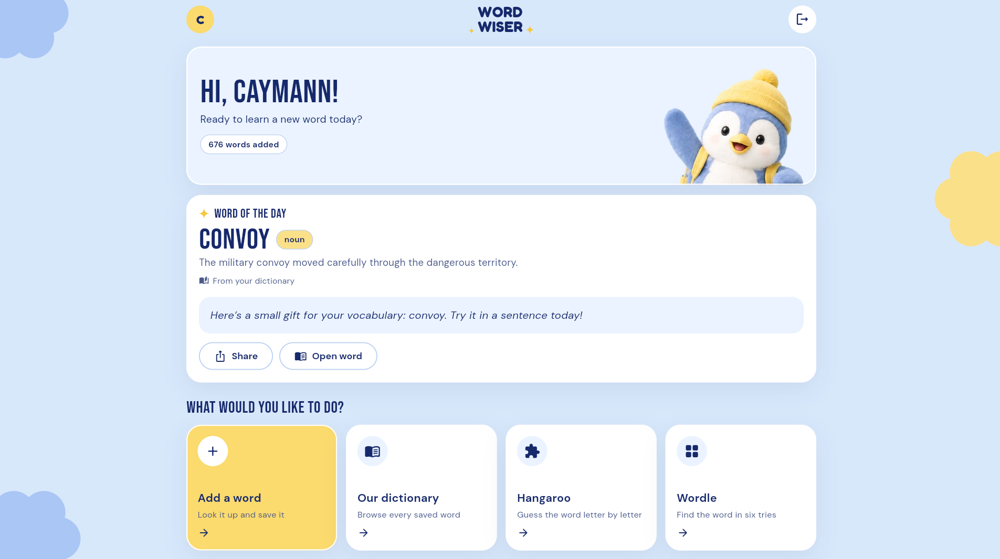
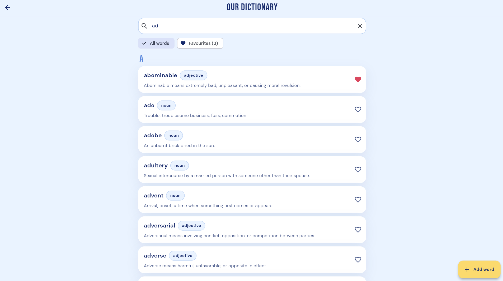
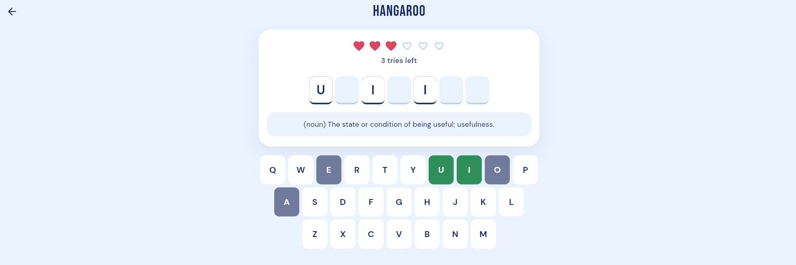
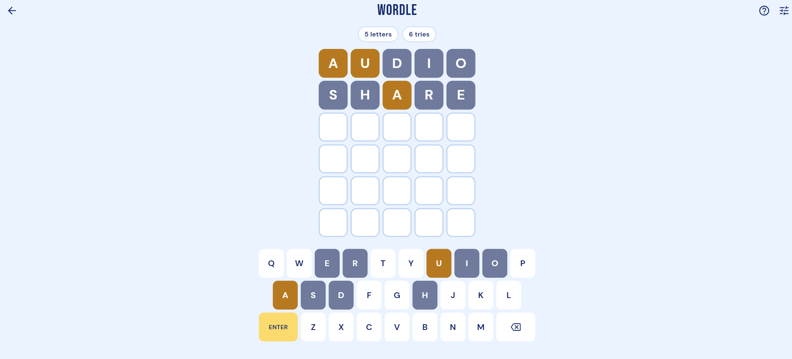

<p align="center">
  
</p>

<h1 align="center">WordWiser</h1>

<p align="center">
  <strong>Learn a new word. Make it yours.</strong><br>
  Look up any word, save it to a dictionary you build together,<br>
  then make it stick with Hangaroo and Wordle.
</p>

<p align="center">
  
  
  
</p>

---

## Screenshots

| Home & word of the day | Our dictionary |
|:---:|:---:|
|  |  |
| **Hangaroo** | **Wordle** |
|  |  |

---

## Features

- **✨ Word of the day.** Every day a word is picked from *your* dictionary (the same word for everyone), and Gemini writes a short, original message that uses it. You can share it or open the word's full page.
- **➕ Smart word lookup.** Type a word and its meaning, example sentence, pronunciation, synonyms and antonyms fill in automatically from [dictionaryapi.dev](https://dictionaryapi.dev). Edit anything before saving, then share it.
- **📖 Shared dictionary.** Every saved word in one A–Z list, with instant search, letter headings and favourites.
- **🧩 Hangaroo.** Guess a dictionary word letter by letter. Hearts show your tries, and there's a hint if you get stuck.
- **🟩 Wordle, your way.** Choose any word length from 3 to 10 letters (or random) and 3–10 tries. Repeated letters are coloured correctly, and it works with the on-screen keyboard or a physical one.
- **👤 Accounts.** Sign up, log in, reset your password, and stay logged in between launches.
- **⚡ Fast and offline-friendly.** Bundled fonts, Firestore offline cache, cache-first game loading and a lazily built dictionary list.
- **📱 Responsive.** Phone, tablet and web layouts.

---

## Getting started

### Requirements
- [Flutter](https://docs.flutter.dev/get-started/install) 3.x (run `flutter doctor`)
- A Firebase project (the free **Spark** plan is enough)

### Run it
```bash
flutter pub get
flutter run            # or: flutter run -d chrome
```

### Firebase setup
1. **Authentication → Sign-in method →** enable **Email/Password**.
2. **Security rules:** deploy the included `firestore.rules`:
   ```bash
   npm install -g firebase-tools
   firebase login
   firebase deploy --only firestore:rules
   ```
3. **To use your own Firebase project:** run `flutterfire configure`. This regenerates `lib/firebase_options.dart` and the platform config files.

### Word of the day (free)
1. Firebase console → **AI Logic** → **Get started** → **Gemini Developer API**. No billing is needed.
2. Firebase console → **App Check** → register your app (Android: Play Integrity, iOS: App Attest, Web: reCAPTCHA v3; put the web site key in `_recaptchaSiteKey` in `lib/main.dart`).
3. In debug builds, copy the **App Check debug token** printed in the console and add it under *App Check → your app → Manage debug tokens*.

The message is generated **once per day** and saved in Firestore (`DailyWord/{yyyy-mm-dd}`), so it uses just one AI request a day. Without AI, a handwritten template message is shown instead.
The model name lives in `DailyWordService.modelName`. If Google retires it, switch to a current one from the [Firebase AI Logic models list](https://firebase.google.com/docs/ai-logic/models).

### App icon
The penguin icon is already set up for the web (favicon + PWA icons). To generate the Android and iOS launcher icons:
```bash
dart run flutter_launcher_icons
```

---

## Tests

```bash
flutter test
```
These cover the Wordle scoring (including repeated letters), Hangaroo rules, word-length settings and the word-of-the-day picking and message checks.

---

## Project structure

```
lib/
├── main.dart                 App entry, offline cache, App Check, AuthGate
├── theme.dart                Brand colours, fonts and component styles
├── models/word_entry.dart    Word model (Firestore fields)
├── services/
│   ├── authentication.dart   Sign up / log in / reset + friendly errors
│   ├── words.dart            Firestore: words, favourites, counts
│   ├── word_api_service.dart Free dictionary lookup
│   └── daily_word_service.dart  Word of the day (dictionary + Gemini)
├── pages/                    Screens + pure game logic (wordle_game, hangaroo_game)
└── widgets/                  Shared UI: cards, buttons, keyboard, logo, daily word
assets/
├── fonts/                    DM Sans, Bebas Neue, Fredoka (SIL OFL)
├── icon/                     App icon sources
└── images/                   Penguin mascot
docs/                         README screenshots and logo
firestore.rules               Database security rules
```

### Data layout
```
Words/{id}                          shared dictionary
Users/{email}/AddedWords/{id}       words a user added
Users/{email}/FavouriteWords/{id}   a user's favourites
DailyWord/{yyyy-mm-dd}              word of the day + message
```

---

## Security notes

- The Firebase values in `firebase_options.dart` / `google-services.json` identify the project and are **not secrets**. Your data is protected by `firestore.rules` and App Check. Restrict the API keys in Google Cloud Console → Credentials.
- **Never commit** signing keys (`*.jks`, `*.keystore`, `key.properties`), service-account JSON files, `.env` files or App Check debug tokens.
- If the repo is public and you don't want others running it against your Firebase project, add `lib/firebase_options.dart` and `android/app/google-services.json` to `.gitignore`. Contributors can then run `flutterfire configure` with their own project.

---

## Credits

- Fonts: [DM Sans](https://fonts.google.com/specimen/DM+Sans), [Bebas Neue](https://fonts.google.com/specimen/Bebas+Neue) and [Fredoka](https://fonts.google.com/specimen/Fredoka), all under the SIL Open Font License (see `assets/fonts/LICENSES.txt`).
- Word data: [Free Dictionary API](https://dictionaryapi.dev).
- Daily messages: Google Gemini via [Firebase AI Logic](https://firebase.google.com/docs/ai-logic).
